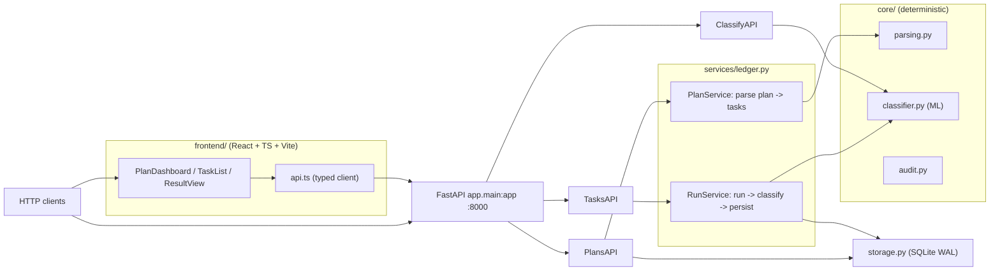

# Nexus Forge — Alan Vo | AI & Machine Learning

> Work in progress. This checkpoint may be incomplete or fail tests. See PLAN.md and STATUS.md before use.


**Problem.** Agentic development workflows that decompose plans into steps record
test results in a ledger by taking the *last non-blank log line* (issue #2342).
For runners like `node --test` that tail is a `# duration_ms …` line that carries
no pass/fail signal, so the ledger stops being evidence. Plans are also written
as a single monolithic document and re-read in full on each step (issue #512),
and long runs can time out and lose progress (issue #809).

**Approach.** Nexus Forge is a plan ledger: it decomposes a markdown plan into
discrete, addressable tasks, executes each against a bounded command, and
classifies the outcome with a **from-scratch logistic-regression log classifier**
trained on a hand-labeled dataset of real test-runner output. The classifier
inspects the whole captured log to emit a runner-independent `passed`/``failed`
label, so the ledger records meaningful evidence even when the runner's last line
is only a duration. The core is **deterministic and offline**: no LLM key is
required. Advisory LLM explanation is an opt-in future milestone.

**Intended user.** Developers and agent operators who run scripted, multi-step
work and want a durable, queryable ledger of which steps passed or failed,
independently of which test runner produced the logs.

> This is a Round-1 checkpoint. Authentication (OIDC/Keycloak) and full LLM
> provider adapters are planned milestones — see [STATUS.md](./STATUS.md). The
> API is currently unauthenticated and intended for local/development use behind
> an OIDC gateway in any real deployment.

## Features

- **Plan decomposition.** Parse markdown `- [ ]`/`- [x]` task lists (or
  `## Task N:` headings / numbered steps) into ordered, addressable tasks with
  stable IDs — the "per-task step files" suggested in issue #512, materialized as
  ledger entries.
- **Bounded task execution.** Run a task via a subprocess with a bounded timeout;
  capture stdout + stderr, exit code, duration, and the first/last non-blank
  lines.
- **ML outcome classification.** A pure-Python bag-of-counts logistic regression
  (trained once, deterministic seed) labels outcomes from the full log, fixing
  the duration-line evidence gap from #2342 and surfacing `classifier-conflict`
  when a runner's tail disagrees with the exit code.
- **Durable ledger.** SQLite (WAL) storage of plans, tasks, outcomes and an audit
  log with UTC timestamps, pagination, filtering and CSV export.
- **Typed frontend dashboard.** React + TypeScript + Vite dashboard with plan
  create/list/detail, task run with a demo command, a results ledger view with
  filters, and classifier metrics.

## Install

```bash
# Backend (Python 3.12)
python3 -m venv .venv
.venv/bin/pip install -r backend/requirements.txt

# Frontend
npm --prefix frontend install
```

## Run

```bash
# Local API (same entrypoint as Docker)
PYTHONPATH=backend .venv/bin/uvicorn app.main:app --host 127.0.0.1 --port 8000

# Local dev dashboard
npm --prefix frontend dev            # http://127.0.0.1:5123 (proxies to API)

# ...or everything via compose (loopback-only)
docker compose -f compose.yaml --profile frontend up --build
```

A local demo mode is available by setting `NEXUS_ENV=dev NEXUS_DEMO=1`; the app
refuses to start in demo mode when `NEXUS_ENV` is anything other than `dev`.

## Test

```bash
# Backend
PYTHONPATH=backend .venv/bin/python -m pytest backend/tests

# Frontend
npm --prefix frontend test
npm --prefix frontend run build      # typecheck + production build
```

## Usage (end-to-end)

```bash
# 1. Create a plan
P=$(curl -s -X POST http://127.0.0.1:8000/plans \
  -H 'Content-Type: application/json' \
  -d '{"name":"smoke","text":"- [ ] t"}')
PLAN_ID=$(echo "$P" | python3 -c "import sys,json;print(json.load(sys.stdin)['id'])")

# 2. Run its first task
TASK_ID=$(curl -s "http://127.0.0.1:8000/plans/$PLAN_ID" | python3 -c "import sys,json;print(json.load(sys.stdin)['tasks'][0]['id'])")
curl -s -X POST "http://127.0.0.1:8000/tasks/$TASK_ID/run" \
  -H 'Content-Type: application/json' \
  -d '{"command":["sh","-c","printf \"# pass 4\\n# fail 0\\n# duration_ms 1\\n\""],"timeout":30}'

# 3. Inspect the ledger
curl -s "http://127.0.0.1:8000/results"
```

## AI/ML evaluation

The offline classifier is a from-scratch logistic-regression model over four
real-valued features (pass count, fail count, presence of a success token,
presence of a failure token). It is trained in-process with SGD on a fixed
random seed, so results are reproducible.

**Data provenance.** `backend/app/core/classifier.py` ships `DATASET`: 33
hand-labeled log snippets drawn from real runner output (`node --test` tap-like
`#.pass`/`# fail`/`# duration_ms` lines, `pytest`, `jest`, and `go test` `---
PASS`/`--- FAIL` summaries). No customer data is used; the dataset is part of the
public source tree and exposed verbatim at `GET /classify/dataset`.

**Reproducible command (offline, no key):**

```bash
PYTHONPATH=backend .venv/bin/python -c "from app.core import classifier; print(classifier.evaluate())"
```

Or, with the server running:

```bash
curl -s http://127.0.0.1:8000/classify/metrics
```

**Baseline.** Logistic regression is intentionally a transparent, dependency-free
baseline — not a substitute for a large language model. It has no trainable
parameters that change at runtime and makes no external calls.

**Measured results (this checkpoint, deterministic split, seed 7):**

| Metric    | Value | Split (train/test) |
|-----------|-------|--------------------|
| Accuracy  | 1.0000 | 23 / 10 |
| Precision | 1.0000 | — |
| Recall    | 1.0000 | — |
| F1        | 1.0000 | — |

**Failure cases / limitations.**
- The dataset is tiny (33 examples). Accuracy drops on runner output outside the
  dataset; the model is calibrated for the common TAP/pytest/jest/go shapes it was
  trained on.
- A bare `# duration_ms 52` line with no pass/fail tokens is ambiguous and is
  treated as a classifier-conflict; the orchestrator defers to the exit code when
  one is present.
- The classifier is advisory. Exit code is authoritative for recorded outcomes;
  disagreements are flagged with `agreement: "classifier-conflict"` in the ledger
  row rather than silently overwritten.

## Architecture



## Provider configuration (LLM — future milestone)

LLM-backed advisory explanations are not yet enabled. When implemented, the only
credential variable will be `LLM_API_KEY`; `LLM_PROVIDER`, `LLM_MODEL`,
`LLM_BASE_URL` are optional non-secret settings. No provider is preset and no key
is ever embedded.

| Provider key | Adapter (planned) | Default base URL |
|---|---|---|
| `openai-compatible` | OpenAI-compatible (LiteLLM/OpenRouter/Ollama) | from `LLM_BASE_URL` |
| `anthropic` | Anthropic Messages | `https://api.anthropic.com` |
| `gemini` | Gemini generateContent | `https://generativelanguage.googleapis.com` |
| `ollama` | Ollama | `http://127.0.0.1:11434` |

## Security

- **Auth is not yet implemented** in this checkpoint (planned milestone
  `auth-oidc`: Keycloak authorization-code with state/nonce/PKCE and role-based
  authorization). The API is unauthenticated and must be fronted by an OIDC
  gateway (or the `auth`-profile Keycloak in compose) before any real deployment.
- A local demo mode exists (`NEXUS_ENV=dev NEXUS_DEMO=1`, loopback only). The
  service refuses demo mode in production (`NEXUS_ENV=production`).
- No real credentials, tokens or private URLs are committed. `.env` is
  gitignored; see `.env.example`.
- **SSO/SAML.** When the auth milestone lands, Keycloak will broker a SAML IdP
  via its identity-broker SPI (realm import under `realm-export/`). This repo
  will not implement SAML natively — operators configure the IdP in Keycloak.

## Repository layout

```
backend/app/{api,core,models,services,main.py}   # FastAPI + domain engine
backend/tests/                                    # pytest
frontend/src/{api,components,App.tsx,main.tsx}    # React dashboard
frontend/tests/                                   # vitest
docs/api.md, docs/architecture.md                 # documentation
compose.yaml, backend/Dockerfile, frontend/Dockerfile
```

---

Copyright © 2026 Alan Vo <alanvo@gmail.com> · Released under the MIT License.